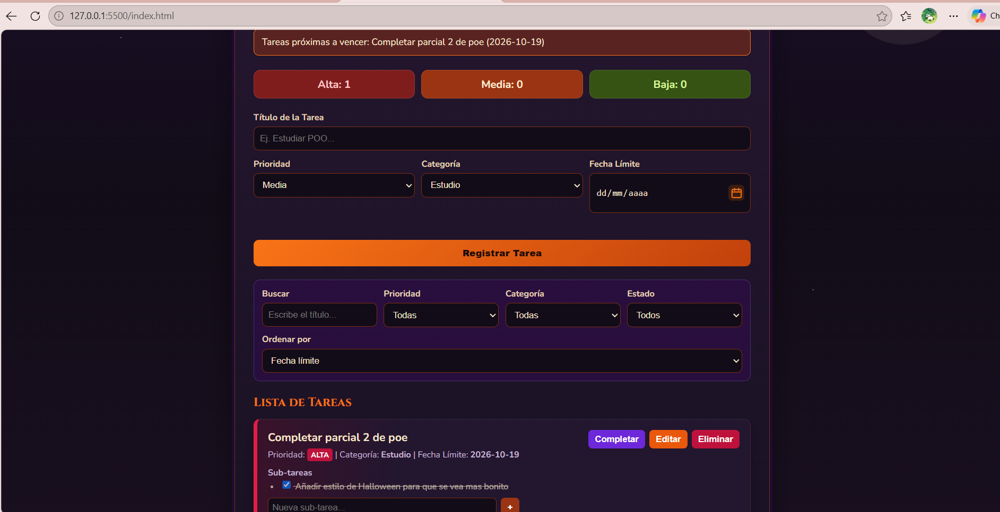
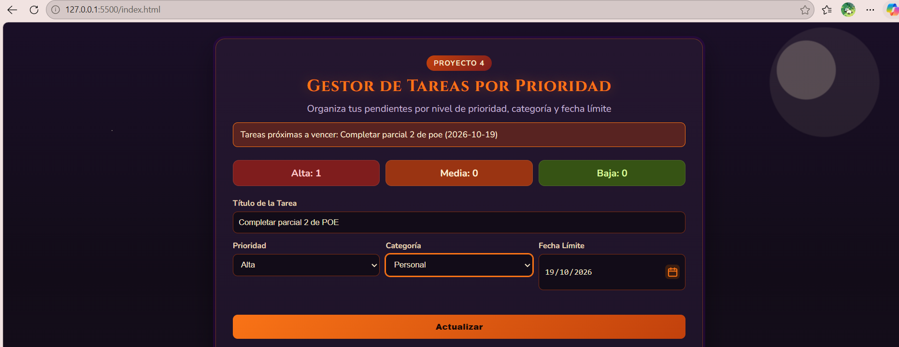
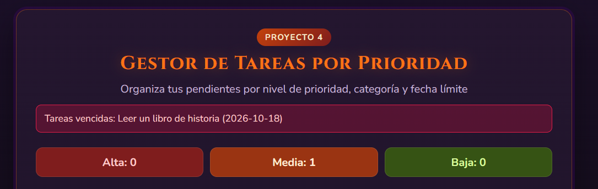
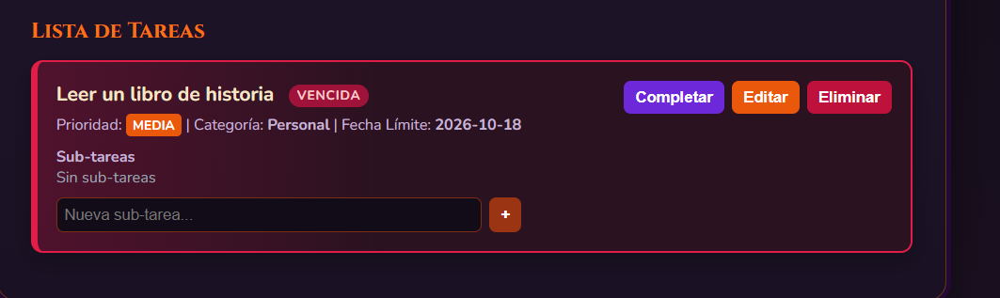

# PROYECTO 4 -- PARCIAL DE POE
# ESTUDIANTE: NICOLE ESTEFANIA RAMOS ARIAS

## Gestor de Tareas por Prioridad

Esta app es para organizar tareas pendientes por prioridad, categoría y fecha límite. La hice en TypeScript siguiendo MVC (modelo, vista y controlador). Las tareas se quedan guardadas en el navegador, entonces aunque recargue la página no se pierden las tareas registradas anteriormente.

**Importante:** no abra `index.html` con doble clic. Hay que abrirlo con **Live Server**, si no el navegador no carga bien los archivos.

## Requisitos para ejecutarlo

- Visual Studio Code
- Extensión **Live Server**
- Node.js, solo si vas a instalar dependencias o volver a compilar TypeScript

## Cómo ejecutarlo (GitHub)

```bash
git clone <URL-del-repositorio>
cd "<nombre-de-la-carpeta-del-proyecto>"
npm install
npx tsc
```
Después, da click derecho en `index.html` y selecciona de opcion `Open with Live Server`

## Documento técnico: mejoras y decisiones

En este parcial partí de un gestor simple que permitiera agregar, listar, completar y eliminar. Asegurandome de que: no se borre todo al recargar, que se pueda editar, buscar, filtrar y que avise cuando algo está mal.

### Cambios realizados y por qué

**1. Que las tareas no se pierdan**  
Guardar todo en `localStorage` y meter esa parte en una clase `StorageService`. Así el guardado queda en un solo lugar y no se mezcla con el diseño ni con los botones. Cuando se abre la página, el modelo carga lo que ya estaba guardado.

**2. Editar una tarea sin borrar y volver a crearla**  
Es necesario porque si uno se equivoca en el título o en la fecha, no tiene sentido borrarla y volverla a registrar. Al dar clic en **Editar**, los datos se pasan al formulario y se podran realizar los cambios que se quieran hacer y el botón cambia a **Actualizar**. Cuando se guarda, se modifica la misma tarjeta de la tarea.

**3. Buscar y filtrar al mismo tiempo**  
Puse un buscador que se actualiza mientras uno escribe (`input`) y los selects de prioridad, categoría y estado que cambian con `change`para asi si hay muchas tareas, al poner su titulo o palabras similares pueda encontrar mas facilmente la tarea en especifico que esta buscando.

**4. Validaciones extra para el proyecto**  
Si no se llena un campo, saldran mensajes distintos si:
- no hay título
- no se ha ingresado una fecha límite
- si ya existe una tarea con el mismo título

Eso último lo puse porque era muy fácil registrar dos veces lo mismo sin querer.

**5. El estilo Halloween**  
Esto no era obligatorio. Lo hice en CSS para que no se viera como un formulario plano blanco.

**6. Notificaciones de tareas próximas a vencer**  
El reto extra era que el navegador avisara si una tarea estaba por vencer. Al principio lo puse para que pidiera permiso solo al abrir la página y avisara únicamente si la fecha era exactamente hoy o mañana. Al inicio no salía ningún aviso, aunque sí habian tareas cerca de vencerse, para identificar el problema y resolverlo le pedi ayuda a una IA y ella me dio las siguientes soluciones.

Por ahora:
- hay un botón **Activar avisos del navegador** que al darle click da las respectivas indicaciones: dar clic al icono del lado izquierdo en la barra de direccion y elegir permitir las notificaciones.
- en la página se ve un recuadro con las tareas que vencen en 0 a 2 días y las que ya vencieron.
- si el permiso está dado, también sale la notificación del sistema al guardar la tarea

Si el botón dice que los avisos están bloqueados, hay que ir al candado de la barra de dirección → Notificaciones → Permitir, y recargar.

### Cómo está organizado

`index.html` | Lo que se ve: formulario, buscador, filtros y lista
`src/models/Tarea.ts` | Cómo es una tarea y las reglas (agregar, editar, filtrar, duplicados)
`src/views/TareasView.ts` | Dibuja las tarjetas y conecta los clics 
`src/controllers/TareaController.ts` | Junta el modelo con la vista 
`src/services/StorageService.ts` | Guarda y lee el `localStorage`
`src/styles/styles.css` | El tema Halloween 
`dist/` | El JavaScript que realmente abre el navegador


## Capturas de pantalla

1. Captura de el formulario con una tarea registrada.

2. Captura mostrando el modo **Actualizar** (después de dar Editar).

3. Captura del mensaje cuando una tarea se vence.

4. Captura de tarjeta de tarea de prueba vencida

